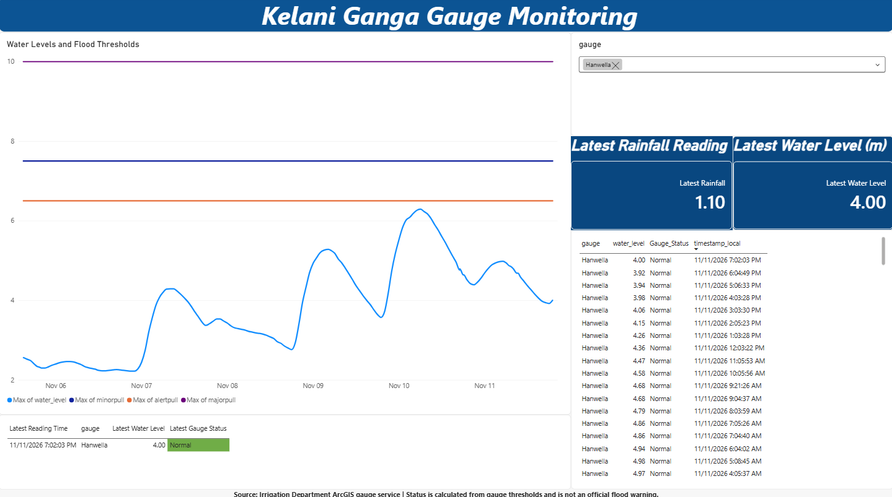

# Kelani Ganga Gauge Monitoring Dashboard

A beginner portfolio project that monitors river gauge readings for selected stations along the Kelani Ganga.

## Dashboard Features

- Historical water-level trend chart with gauge thresholds
- Latest water level, rainfall reading, and calculated gauge status
- Station selector
- Recent gauge-reading history table

## Data Source

Gauge readings are collected from the Irrigation Department ArcGIS gauge service.

## Project Files

- `collect_kelani_gauges.py` — collects gauge readings and appends new records to the history CSV
- `kelani_gauge_history.csv` — collected gauge-reading history
- `SL_Flood_Intelligence.pbix` — Power BI dashboard

## How to Update the Data

1. Run `collect_kelani_gauges.py` to collect new readings.
2. Open the Power BI report.
3. Select **Home > Refresh** to load the updated CSV data.

The collector is scheduled to run every 30 minutes while the computer is on and the user is logged in. Power BI Desktop still needs to be refreshed manually.

## Important Note

Gauge statuses are calculated from the thresholds in the collected data. They are for portfolio demonstration only and are not official flood warnings or emergency guidance.
